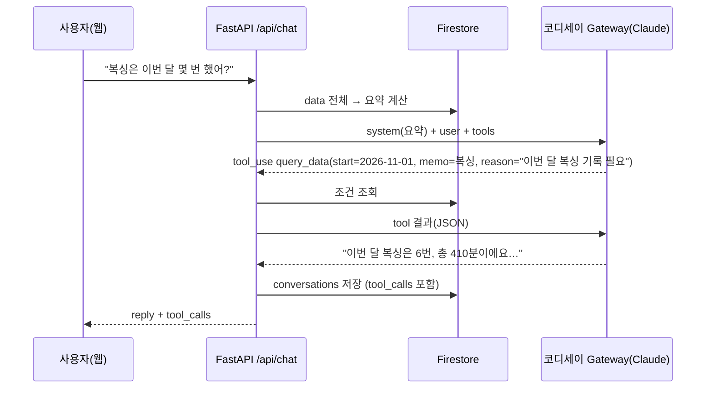
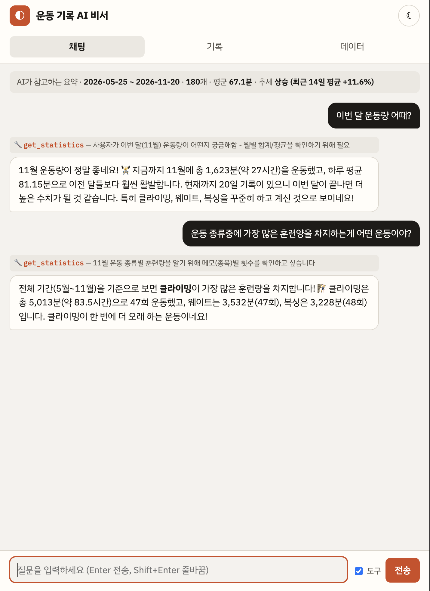

# 🏋️ 운동 기록 AI 비서 — 내 데이터를 아는 AI

일반 챗봇은 "이번 달 운동 많이 했어?"라고 물으면 일반론만 답합니다.
이 서비스는 **내 일일 운동 시간(분) 시계열 데이터**를 Firestore에 저장·분석하고, 그 **요약을 시스템 프롬프트에 주입**해서
"이번 달 합계 1,420분, 최근 14일 평균이 직전보다 11% 늘었어요"처럼 **내 상황에 맞춘 답**을 줍니다.

| 구분 | 주소 |
|---|---|
| 프론트엔드 (Vercel) | https://ai-assistant-frontend-virid.vercel.app |
| 백엔드 API (Render) | https://ai-assistant-api-ecqq.onrender.com |
| Swagger UI | https://ai-assistant-api-ecqq.onrender.com/docs |

> Render 무료 티어는 15분간 요청이 없으면 잠듭니다. 첫 접속은 30~60초 걸릴 수 있으며, 화면 상단에 안내 배너가 뜨고 자동으로 `/health`를 재시도합니다.

> **실행 증거**: 배포 환경에서 실제로 호출한 결과(프론트·API·Swagger HTTP 200, CRUD 왕복, Firestore 저장 확인, 데이터 → 요약 → 채팅 반영, 대화 저장·불러오기, 422 검증, 모바일 점검 10/10)를 [**docs/EVIDENCE.md**](docs/EVIDENCE.md)에 텍스트 로그로 정리했습니다.

---

## 1. 주요 기능

| 기능 | 내용 |
|---|---|
| 데이터 기반 AI 채팅 | 질문 → 요약 조회 → 시스템 프롬프트 주입 → AI 답변, 로딩 표시, 대화 자동 저장 |
| 데이터 관리 (CRUD) | `(date, value, memo)` 추가 / 목록 / 수정 / 삭제, 저장 결과 토스트 |
| 대화 기록 | 대화 목록, 클릭해 불러오기(메시지 재표시), 삭제, 이어서 대화 |
| 데이터 요약 | 기간·개수·평균·최대·합계·최근 추세를 채팅 상단과 우측 패널에 표시 |
| **보너스** | Function Calling(도구 4종) + MCP 서버, 확장 통계 API, SVG 추세 그래프, CSV/JSON 내보내기, 다크 모드 |

## 2. 기술 스택

- **Backend**: Python 3.11, FastAPI, Uvicorn, Pydantic v2, firebase-admin(Firestore), python-dotenv (AI 호출은 표준 라이브러리 urllib) → **Render**
- **Frontend**: HTML / CSS / JavaScript (프레임워크·차트 라이브러리 없음, 그래프는 SVG 직접 렌더링) → **Vercel**
- **DB**: Firebase Firestore (`data`, `conversations` 컬렉션)
- **AI**: 코디세이 AI Gateway(`copa.codyssey.kr`, 기본 모델 `claude-haiku-4`) — Anthropic Messages 형식 기본, OpenAI 호환 형식 자동 전환, 두 형식 모두 Function Calling(도구 호출) 지원
  - 과제 명세는 GPT API(openai 패키지)를 예시로 들지만, 코디세이에서 제공하는 Gateway 키를 사용하도록 바꿨습니다. 컨텍스트 주입·도구 호출 구조는 동일합니다.
- **Bonus**: MCP Python SDK (`mcp`)

## 3. 프로젝트 구조

```
ai-assistant/
├── backend/
│   ├── main.py                 # 앱 초기화, CORS, 라우터 등록, /health, 전역 예외 처리
│   ├── app/
│   │   ├── config.py           # 환경 변수 로딩 (키 하드코딩 없음)
│   │   ├── database.py         # Firestore Repository (+ 로컬 테스트용 Memory)
│   │   ├── schemas.py          # Pydantic 요청/응답 모델 (입력 검증)
│   │   ├── routers/            # HTTP 계층: data.py, conversations.py, chat.py
│   │   └── services/           # 비즈니스 로직
│   │       ├── data_service.py          # CRUD
│   │       ├── summary_service.py       # 요약·트렌드·확장 통계
│   │       ├── conversation_service.py  # 대화 저장/목록/상세
│   │       ├── chat_service.py          # 컨텍스트 주입 + AI 호출 + 자동 저장
│   │       ├── llm.py                   # 코디세이 Gateway 클라이언트 (Anthropic/OpenAI 형식, 도구 호출)
│   │       └── tools.py                 # Function Calling 도구 정의/실행
│   ├── data/workout_log.csv    # 시계열 데이터 180일
│   ├── scripts/seed_data.py    # CSV → Firestore 업로드
│   ├── tests/test_services.py  # Firebase·AI 키 없이 도는 테스트 (가짜 Gateway)
│   ├── requirements.txt
│   └── .env.example
├── frontend/
│   ├── public/ (index.html, style.css, app.js, config.js)
│   ├── build.js               # Vercel 환경변수 API_BASE_URL → config.js
│   └── vercel.json
├── frontend/tests/mobile_check.py  # 모바일(iPhone 13) 사용성 자동 점검
├── docs/EVIDENCE.md           # 배포 환경 실행 증거(텍스트 로그)
├── mcp_server/server.py       # (보너스) MCP 서버
└── render.yaml
```

**분리 기준**: `routers`는 HTTP(경로·상태코드·의존성)만, `services`는 순수 로직만 담당합니다. 서비스는 FastAPI를 import하지 않아서 테스트·MCP·스크립트에서 그대로 재사용되고, DB 접근은 `Repository` 인터페이스로 감싸 Firestore ↔ 메모리 저장소를 바꿔도 로직이 바뀌지 않습니다.

## 4. 데이터 선정과 분석

- **데이터**: 2026-05-25 ~ 2026-11-20, **180일**의 일일 운동 시간(분). 메모에 종목(웨이트·복싱·클라이밍·러닝·휴식) 기록. 10월 셋째 주는 중간고사로 감소 구간이 있습니다.
- **요약 (`GET /api/data/summary`)**: 기간, 개수, 합계/평균/최대/최소(+해당 날짜), **트렌드** = 마지막 날짜 기준 *최근 14일 평균* vs *직전 14일 평균* 변화율 (±5% 이내 '유지')
- **확장 통계 (`GET /api/data/statistics`, 보너스)**: 중앙값, 표준편차, 활동일 비율, 최장 연속 운동일, 요일별 평균, 월별 합계/평균, 7일 이동평균, 종목별 횟수

```json
{
  "period": "2026-05-25 ~ 2026-11-20",
  "count": 180,
  "metrics": { "total": 12086.0, "average": 67.14, "max": 131.0, "min": 0.0,
               "max_date": "2026-09-12", "min_date": "2026-06-14" },
  "trend": "상승 (최근 14일 평균 +11.6%)",
  "recent_average": 82.43, "previous_average": 73.86, "unit": "분"
}
```

> 내 실제 기록으로 바꾸려면 `date,value,memo` 헤더의 CSV를 만들어 `python scripts/seed_data.py --csv 내파일.csv --reset` 하세요. 다른 종류의 데이터라면 환경 변수 `DATA_LABEL`, `DATA_UNIT`만 바꾸면 프롬프트에 반영됩니다.

## 5. API

| 메서드 | 경로 | 설명 |
|---|---|---|
| POST | `/api/data` | 데이터 추가 (201) |
| GET | `/api/data?start=&end=&limit=` | 목록 (날짜 오름차순) |
| PUT | `/api/data/{id}` | 수정 (보낸 필드만 부분 수정) |
| DELETE | `/api/data/{id}` | 삭제 |
| GET | `/api/data/summary` | 요약 (프롬프트 주입용) |
| GET | `/api/data/statistics` | 확장 통계 (보너스) |
| POST | `/api/conversations` | 대화 저장 |
| GET | `/api/conversations` | 대화 목록 — **messages 미포함**(제목·미리보기·개수만) |
| GET | `/api/conversations/{id}` | 대화 상세 — 전체 messages (요구사항 **A안**) |
| DELETE | `/api/conversations/{id}` | 대화 삭제 |
| POST | `/api/chat` | AI 대화 `{message, conversation_id?, use_tools}` |
| GET | `/health` | 헬스 체크 |

**입력 검증 (Pydantic)**: 날짜 형식, `0 ≤ value ≤ 1,000,000`, 무한대/NaN 거부, 메모 200자, 채팅 메시지 1~2000자·공백만 금지 → 위반 시 422. 없는 ID는 404, AI 호출 실패는 502(한도 초과 429), 키 미설정은 503, 그 외 예외는 내부 내용 노출 없이 500.

검증 실패 예시 (배포 서버 실측, [EVIDENCE §3](docs/EVIDENCE.md#3-입력-검증-pydantic--422)):

```http
POST /api/data   {"date": "2026-13-40", "value": -5}
→ 422 {"detail": [
    {"loc": ["body","date"],  "msg": "Input should be a valid date or datetime, month value is outside expected range of 1-12"},
    {"loc": ["body","value"], "msg": "Input should be greater than or equal to 0"}]}

POST /api/chat   {"message": "   "}
→ 422 {"detail": [{"loc": ["body","message"], "msg": "Value error, 빈 메시지는 보낼 수 없습니다."}]}
```

## 6. 컨텍스트 주입 원리

언어 모델은 학습 데이터 외에 **이번 요청 메시지**만 압니다. 그래서 매 요청마다 DB에서 요약을 계산해 **system 메시지**에 텍스트로 넣어 주면, 모델은 그 숫자를 "사실"로 보고 답합니다. 전체 180행 대신 요약만 넣으므로 토큰(=비용)이 적고, 데이터를 수정하면 다음 질문부터 바로 반영됩니다.

```
당신은 사용자의 개인 데이터를 이해하는 데이터 분석 비서입니다.

[사용자 데이터 요약]
- 데이터 종류: 일일 운동 시간 (단위: 분)
- 데이터 기간: 2026-05-25 ~ 2026-11-20
- 총 레코드: 180개
- 주요 지표: 합계 12086.0분, 평균 67.14분, 최대 131.0분(2026-09-12), 최소 0.0분(2026-06-14)
- 최근 트렌드: 상승 (최근 14일 평균 +11.6%) (최근 14일 평균 82.43분, 직전 14일 평균 73.86분)

오늘 날짜: 2026-11-21 (Asia/Seoul)
규칙: 요약·도구 결과의 숫자만 근거로 답하고 없는 수치는 지어내지 말 것 …
```

`POST /api/chat` 흐름: ① 요약 조회 → ② 시스템 프롬프트 삽입 (+ 이어지는 대화면 최근 10개 메시지) → ③ 코디세이 Gateway 호출 → ④ user/assistant 메시지를 `conversations`에 자동 저장 (새 대화면 문서 생성, 아니면 append)

런타임 증거: 데이터를 추가한 직후 **도구를 끈 채**(`use_tools:false`) 질문해도 AI가 새 기록(오늘 140분, 최고 기록)을 답합니다. DB를 직접 볼 방법이 없으므로 주입된 요약만으로 답한 것입니다 → [EVIDENCE §4](docs/EVIDENCE.md#4-데이터--요약--채팅-반영-흐름-컨텍스트-주입-런타임-증거).

### 6-1. 요약 API를 따로 둔 이유 (책임 분리·재사용)

요약 계산은 `summary_service.compute_summary()` **한 곳**에만 있고, 같은 함수를 여러 소비자가 씁니다. 그래서 "화면에 보이는 요약"과 "AI가 받는 요약"이 절대 어긋나지 않습니다.

| 소비자 | 사용 방법 | 목적 |
|---|---|---|
| `POST /api/chat` (chat_service) | 함수 직접 호출 → `summary_to_prompt()` → system 프롬프트 | 컨텍스트 주입 |
| 웹 프론트 | `GET /api/data/summary` | 채팅 상단 요약 바, 데이터 패널 카드 |
| AI 도구 `get_data_summary` | 함수 직접 호출 | 대화 도중 최신 요약 재확인 |
| MCP 서버 (Claude Desktop 등) | `GET /api/data/summary` | 외부 채널에서 같은 요약 사용 |
| `scripts/seed_data.py --dry-run` | 함수 직접 호출 | 업로드 전 CSV 요약 미리보기 |
| 응답 `ChatResponse.summary` | 이번 요청에 주입된 요약을 그대로 반환 | 어떤 맥락으로 답했는지 추적 |

다른 클라이언트에서 재사용하는 예:

```bash
curl -s https://ai-assistant-api-ecqq.onrender.com/api/data/summary
# 다른 LLM/스크립트의 프롬프트에 그대로 붙여 넣거나, 대시보드·알림(예: 추세가 '하락'이면 메일)에 사용
```

요약을 별도 API로 두면 ① 프롬프트 형식(텍스트)과 데이터 형식(JSON)을 분리할 수 있고, ② 요약 규칙(기간·임계값)을 바꿀 때 한 파일만 고치면 되며, ③ 단위 테스트(`tests/test_services.py`)에서 DB·AI 없이 검증할 수 있습니다.

### 6-2. 컨텍스트 주입의 장단점과 한계, 보완 방법

| 장점 | 단점·위험 |
|---|---|
| 매 요청 최신 데이터가 반영됨 (수정 즉시) | 요약에 없는 **세부 질의는 답할 수 없음** (예: "11월 3일 뭐 했어?") |
| 전체 행 대신 요약 6줄 → 토큰·비용이 작고 일정 | 요약 지표 선택이 곧 AI의 시야 → 빠진 지표는 **지어낼 위험(환각)** |
| 학습·파인튜닝 없이 개인화 | 데이터가 매우 커지면 요약 계산(전체 조회) 비용 증가 |
| 구현이 단순하고 디버깅이 쉬움 (프롬프트가 곧 근거) | 사용자 데이터가 프롬프트에 들어가므로 메모에 섞인 지시문(프롬프트 인젝션) 가능성 |

실제로 겪을 수 있는 오류 사례와 이 프로젝트의 보완:

1. **세부 질의 불가** → Function Calling 도구(`query_data`, `get_statistics`)로 필요할 때만 원본을 조회 (요약 + 검색의 하이브리드). 도구를 끄면 요약 범위 밖 질문에 "데이터가 없다"고 답하도록 규칙을 둠.
2. **수치 환각** → 시스템 프롬프트에 "요약·도구 결과의 숫자만 근거로" 규칙, `temperature 0.4`, 응답에 사용한 요약(`summary`)과 도구 호출(`tool_calls`)을 함께 반환해 사람이 검증 가능.
3. **오래된 대화 맥락** → 이전 대화는 최근 10개만 전달하고, 요약은 매 요청 새로 계산하므로 "예전 답변의 숫자"보다 "현재 요약"이 우선.
4. **규모 증가** → 현재는 전체 조회 후 계산(수천 건까지 충분). 커지면 요약을 데이터 변경 시점에 미리 계산해 `summaries/latest` 문서에 캐시하는 방식으로 전환.
5. **프롬프트 인젝션** → [15. 보안](#15-보안-위협과-대응) 참고.

### 6-3. 요약 기간(TREND_WINDOW) 조정의 영향

`summary_service.py`의 `TREND_WINDOW = 14`(최근 N일 vs 직전 N일), `TREND_THRESHOLD = 5.0`(±5% 이내 '유지')

| 변경 | 기대 동작 | 영향 |
|---|---|---|
| 창을 줄임 (예: 7일) | 최근 변화에 민감 | 휴식일 1~2일로도 '하락' 판정 → 추세 라벨이 자주 바뀜 |
| 창을 늘림 (예: 30일) | 추세가 부드러워짐 | 시험 기간 같은 단기 변화가 늦게 반영. 비교에 최소 60일 데이터 필요 |
| 임계값을 올림 (예: 10%) | '유지' 판정이 늘어남 | 작은 개선은 '유지'로 묶임 |

요약 텍스트 길이는 창 크기와 무관하므로 **토큰·비용은 변하지 않습니다.** 데이터가 `2 × 창` 일수보다 적으면 "판단 불가 (비교 기간 데이터 부족)"로 표시됩니다.

## 7. 보너스 ① — Function Calling + MCP

요약만으로는 "11월 3일엔?", "복싱은 몇 번?" 같은 질문에 답할 수 없습니다. 그래서 AI가 **스스로 판단해** 내부 기능을 호출하도록 도구 4개를 정의했습니다. 모든 도구는 `reason`(호출 근거) 인자를 필수로 받고, 이 값이 채팅 화면의 🔧 칩과 API 응답 `tool_calls`에 그대로 표시됩니다.

| 도구 | 호출 근거 (언제 부르나) |
|---|---|
| `get_data_summary` | 요약이 방금 바뀌었거나 최신 전체 수치가 필요할 때 |
| `get_statistics` | 요일별·월별·종목별 비교, 연속 기록 질문 |
| `query_data(start_date, end_date, memo_keyword, limit)` | "이번 달", "지난주", "복싱한 날" 등 특정 기간/항목 |
| `list_conversations(limit)` | "전에 뭐 물어봤지?" |



라운드는 최대 3회로 제한해 무한 호출·과금을 막습니다. 채팅 입력창의 **도구** 체크를 끄면 요약 주입만으로 답합니다(비교 실험용).

**MCP 서버 (외부 채널)** — `mcp_server/server.py`는 같은 기능을 MCP 도구(`get_data_summary`, `get_statistics`, `query_data`, `add_record`, `list_conversations`, `ask_assistant`)로 노출합니다. MCP 서버는 배포된 REST API만 호출하므로 AI/Firebase 키는 Render에만 있습니다.

```bash
cd mcp_server && python -m venv .venv && source .venv/bin/activate
pip install -r requirements.txt
```

Claude Desktop `claude_desktop_config.json`:
```json
{
  "mcpServers": {
    "workout-assistant": {
      "command": "/절대경로/mcp_server/.venv/bin/python",
      "args": ["/절대경로/mcp_server/server.py"],
      "env": { "API_BASE_URL": "https://ai-assistant-api-ecqq.onrender.com" }
    }
  }
}
```
검증: Claude Desktop에서 "내 운동 요약 알려줘" → `get_data_summary` 호출 확인, "어제 복싱 70분 추가해줘" → `add_record` 후 웹 화면 목록에 반영되는지 확인. (스크린샷: `docs/screenshots/mcp.png`)

## 8. 보너스 ② — 인사이트·UX

- `GET /api/data/statistics`: 추가 지표(중앙값, 표준편차, 최장 연속, 요일별·월별, 종목별)
- 추세 그래프: 일별 값 + 7일 이동평균 SVG (호버/터치 툴팁)
- CSV(엑셀 한글 BOM 포함) / JSON 다운로드
- 다크 모드 토글 (시스템 설정 따름 + 선택 기억)

## 9. 로컬 실행

```bash
# 백엔드
cd backend
python3 -m venv venv && source venv/bin/activate     # Windows: venv\Scripts\activate
pip install -r requirements.txt
cp .env.example .env        # 키 입력 (Firebase 키 파일은 backend/serviceAccountKey.json)
python scripts/seed_data.py # 180개 데이터 업로드 (처음 한 번)
uvicorn main:app --reload   # http://localhost:8000/docs

# 테스트 (Firebase·AI 키 없이)
python tests/test_services.py

# 프론트엔드 (새 터미널)
cd frontend
python3 -m http.server 5500 --directory public      # http://localhost:5500
```

Firebase 키 없이 화면만 확인하려면 `.env`에 `USE_MEMORY_DB=true` 후 `python scripts/seed_data.py`는 건너뛰고 화면에서 데이터를 추가하세요(재시작 시 초기화).

## 10. 환경 변수

| 변수 | 위치 | 필수 | 설명 |
|---|---|---|---|
| `AI_API_KEY` | Render | ✅ | 코디세이 콘솔(copa.codyssey.kr)에서 발급한 키 |
| `FIREBASE_SERVICE_ACCOUNT_JSON` | Render | ✅ | 서비스 계정 JSON 전체(한 줄) 또는 base64. 로컬은 `FIREBASE_CREDENTIALS_PATH` 사용 가능 |
| `ALLOWED_ORIGINS` | Render | ✅ | CORS 허용 도메인, 쉼표 구분 (`https://ai-assistant-frontend-virid.vercel.app`) |
| `API_BASE_URL` | Vercel | ✅ | 백엔드 주소 (빌드 시 `config.js`로 주입) |
| `AI_BASE_URL` | Render | | 기본 `https://copa.codyssey.kr` |
| `AI_MODEL` | Render | | 기본 `claude-haiku-4` (콘솔의 사용 가능 모델명) |
| `AI_API_FORMAT` | Render | | 비우면 자동(Anthropic → 404/405 시 OpenAI 호환), `anthropic`/`openai` 고정 가능 |
| `AI_MAX_TOKENS` | Render | | 기본 500 (비용 제한) |
| `CHAT_HISTORY_LIMIT` | Render | | 프롬프트에 넣을 이전 메시지 수, 기본 10 |
| `DATA_LABEL`, `DATA_UNIT` | Render | | 데이터 이름/단위 (기본 "일일 운동 시간", "분") |
| `USE_MEMORY_DB` | 로컬 | | `true`면 Firestore 대신 메모리 |

`.env`, 서비스 계정 키 파일은 `.gitignore`로 커밋을 막습니다. 프론트의 `API_BASE_URL`은 공개되는 값이라 비밀값을 넣지 않습니다.

## 11. 배포

**Firebase**: 콘솔 → 프로젝트 생성 → Firestore Database 생성 → 프로젝트 설정 › 서비스 계정 › *새 비공개 키 생성* (JSON 다운로드)

**Render (백엔드)**: New › Web Service › Public Git Repository(`https://github.com/JSH-ama-web/ai-assistant`) — 이 방식은 push 시 자동 배포가 안 되므로 코드 변경 후 *Manual Deploy › Deploy latest commit*
- Root Directory `backend` · Build `pip install -r requirements.txt` · Start `uvicorn main:app --host 0.0.0.0 --port $PORT`
- Environment에 위 표의 Render 변수 입력 (`PYTHON_VERSION=3.11.9` 권장) → 배포 후 `/docs` 확인
- 데이터 업로드는 로컬에서 `seed_data.py` 실행 (같은 Firestore를 사용)

**Vercel (프론트엔드)**: Add New › Project › 같은 저장소 › Root Directory `frontend`
- Environment Variables: `API_BASE_URL=https://ai-assistant-api-ecqq.onrender.com` → Deploy
- 배포 URL을 Render의 `ALLOWED_ORIGINS`에 추가 후 재배포 (`*.vercel.app` 프리뷰는 정규식으로 허용됨)

**콜드스타트 대응**: 프론트가 진입 시 `/health`를 최대 6회 재시도하며 안내 배너 표시, 채팅 로딩 8초 초과 시 "서버가 깨어나는 중" 문구로 변경, 요청 타임아웃 90초.

**비용 대응**: `max_tokens=500`, `temperature=0.4`, 도구 라운드 3회 제한, 이력 10개 제한, 전체 데이터가 아닌 요약만 주입. 코디세이 콘솔에서 사용량을 수시로 확인하세요. 배포 후 `/health` 응답의 `ai` 항목으로 키 설정 여부·주소·모델·감지된 형식을 확인할 수 있습니다(키 값은 노출 안 됨).

## 12. 스크린샷

**데이터 요약이 보이는 채팅 화면 (질문 + 답변, 도구 호출 근거 표시)**



**데이터 관리 화면 (요약·추세 그래프·추가 폼)**


**대화 기록 화면 (저장된 대화 목록 → 선택해 불러오기)**


## 13. 데이터 설계 — Firestore 컬렉션

### `data` (시계열 기록, 1일 1문서 권장)

| 필드 | 타입 | 설명 |
|---|---|---|
| `date` | string `YYYY-MM-DD` | 문자열이라 사전순 = 날짜순 → 범위 조회·정렬이 바로 됨 |
| `value` | number | 운동 시간(분), 0 이상 |
| `memo` | string ≤ 200 | 종목 등 자유 메모 |
| `created_at` / `updated_at` | string ISO-8601 (UTC) | 감사·정렬용 |

### `conversations` (대화 1건 = 1문서)

| 필드 | 타입 | 설명 |
|---|---|---|
| `title` | string | 첫 사용자 질문 30자 (자동) |
| `messages` | array of `{role, content, created_at, tool_calls?}` | 대화 전체를 한 문서에 보관 → **한 번의 읽기로 불러오기** |
| `created_at` / `updated_at` | string ISO-8601 | 목록 정렬(최근 수정순) |

**설계 이유**
- 두 데이터는 수명·접근 패턴이 달라 컬렉션을 나눴습니다. `data`는 "기간으로 여러 건 읽기", `conversations`는 "목록 보기 → 한 건 통째로 읽기"입니다.
- 대화를 메시지별 문서로 쪼개지 않고 배열로 둔 이유: 불러오기가 **문서 1회 읽기**(Firestore 과금 단위)로 끝나고, 메시지 순서가 배열 순서로 보장됩니다.
- 문서 ID는 Firestore 자동 ID를 사용해 쓰기가 한 구간에 몰리는 문제(핫스팟)를 피합니다.

**조회 패턴과 인덱스**

| 조회 | 현재 구현 | 데이터가 커졌을 때 Firestore 쿼리 | 필요한 인덱스 |
|---|---|---|---|
| 기간 목록 `GET /api/data?start&end` | 전체 조회 후 서버에서 필터·정렬 (180건 규모) | `where("date", ">=", s).where("date", "<=", e).order_by("date")` | `date` 단일 필드 (자동 생성) |
| 요약·통계 | 전체 조회 후 계산 | 변경 시 미리 계산해 `summaries/latest` 캐시 | 없음 |
| 메모 키워드 (`query_data`) | 서버에서 부분 문자열 검색 | Firestore는 부분 일치 불가 → `tags: ["복싱"]` 배열 필드 + `array_contains` | `tags` 배열 (자동) |
| 대화 목록 (최근순) | 전체 조회 후 `updated_at` 정렬 | `order_by("updated_at", "DESCENDING").limit(20)` | `updated_at` 단일 필드 (자동) |
| 기간 + 메모 동시 조건 | — | `where("tags","array_contains",x).where("date",">=",s)` | **복합 인덱스** `tags` + `date` 필요 (콘솔 오류 링크로 생성) |

주의: Firestore 문서 최대 크기는 1 MiB입니다. 아주 긴 대화가 이 한도에 가까워지면 `conversations/{id}/messages` 하위 컬렉션으로 분리하고, 목록용 `title·preview·message_count`만 상위 문서에 두는 것이 다음 단계입니다.

## 14. 대화 저장 정책

| 항목 | 정책 | 이유 |
|---|---|---|
| 저장 시점 | AI 답변이 **성공한 뒤** user·assistant 메시지를 **한 번에** 저장 | 실패한 요청이 "답 없는 질문"으로 남지 않음. 실패 시 화면에 오류만 표시하고 저장하지 않음 |
| 새 대화 / 이어쓰기 | `conversation_id` 없으면 새 문서 생성, 있으면 기존 배열 뒤에 추가 | 클라이언트가 별도로 저장 API를 부르지 않아도 됨(자동 저장) |
| 저장 형태 | `{role, content, created_at}` + assistant 메시지엔 `tool_calls`(도구 이름·인자·근거) | 나중에 불러와도 "왜 그 답을 했는지" 확인 가능 |
| AI에 다시 보내는 이력 | 최근 10개 메시지의 `role/content`만 (`CHAT_HISTORY_LIMIT`) | 토큰 비용 상한. 도구 기록은 이력에서 제외 |
| 동시성 | 이어쓰기는 "읽기 → 배열 합치기 → 쓰기" (트랜잭션 아님) | 같은 대화에 동시에 두 요청이 오면 한쪽이 덮일 수 있음. 화면은 답변 대기 중 전송 버튼을 막아 순차 전송. 다중 클라이언트로 확장 시 `firestore.ArrayUnion` 또는 트랜잭션으로 교체 |
| 보존 | 자동 삭제 없음. 사용자가 목록의 ×(또는 `DELETE /api/conversations/{id}`)로 삭제 | 개인 기록 서비스 특성상 사용자가 직접 관리 |
| 권장 운영 정책 | `expire_at` 필드 + Firestore **TTL 정책**(예: 90일)으로 오래된 대화 자동 삭제, 메시지 수 상한(예: 200개) | 건강·생활 정보가 담기므로 최소 보존 원칙. 문서 크기 한도 대비 |
| 민감정보 | 키·토큰은 저장하지 않음. 대화 내용은 사용자가 입력한 범위 | 서비스 계정 키는 서버 환경 변수에만 존재 |

## 15. 보안 위협과 대응

| 위협 시나리오 | 대응 (구현 위치) |
|---|---|
| **XSS**: 메모·AI 답변에 `` 같은 HTML이 들어옴 | 화면에 넣기 전 항상 `esc()`로 이스케이프. 말풍선은 이스케이프 **후** `**굵게**`만 `<strong>`으로 변환, 도구 칩·표·대화 목록도 동일 (`frontend/public/app.js`) |
| **CSRF**: 다른 사이트가 사용자 브라우저로 API를 호출 | 쿠키·세션 인증을 쓰지 않아 탈취할 자격 증명이 없음. CORS `allow_credentials=False`, 허용 메서드·헤더 최소화, 허용 도메인은 `ALLOWED_ORIGINS` (`backend/main.py`) |
| **임의 JSON 주입**: 엉뚱한 타입·필드, 거대한 값, `role:"system"` 메시지 위조 | Pydantic이 타입·범위·길이 검증(422). 저장 문서는 서비스가 **허용 필드만 골라** 생성하므로 추가 필드는 버려짐. 대화 role은 `Literal["user","assistant"]` → system 메시지 주입 불가 (`backend/app/schemas.py`) |
| **프롬프트 인젝션**: 메모에 "이전 지시를 무시하고…" 입력 | 메모 원문은 요약에 들어가지 않고 도구 결과(JSON 데이터)로만 전달. 도구는 전부 **읽기 전용**이라 AI가 데이터를 바꾸거나 지울 수 없음. 시스템 프롬프트에 근거 규칙, 메모 200자 제한 |
| **비용 공격**: 반복 호출로 AI 사용량 소진 | `max_tokens=500`, 도구 라운드 최대 3회, 이력 10개 제한, 메시지 2000자 제한, 429 응답을 사용자에게 안내. (개선: IP별 요청 제한 미들웨어 추가) |
| **키 노출** | AI 키·Firebase 키는 Render 환경 변수에만. `.gitignore`로 커밋 차단, `/health`는 키 **설정 여부만** 표시. 프론트의 `API_BASE_URL`은 공개 값만 |
| **내부 정보 노출** | 처리되지 않은 예외는 스택·메시지 없이 500 "서버 내부 오류"만 반환, 상세는 서버 로그에만 |
| **Firestore 직접 접근** | 보안 규칙이 프로덕션 모드(`allow read, write: if false`) → 브라우저에서 DB 직접 접근 불가, Admin SDK(서버)만 접근 |

## 16. 운영 체크리스트

### 환경 변수 문제 해결

| 증상 | 확인 | 조치 |
|---|---|---|
| 채팅 503 "AI_API_KEY 가 설정되지 않았습니다" | `GET /health` → `ai.api_key_set: false` | Render › Environment에 `AI_API_KEY` 입력 후 저장(자동 재배포) |
| 채팅 502 "AI 인증 실패(401/403)" | 키 앞뒤 공백·만료 | 코디세이 콘솔에서 키 재확인 |
| 채팅 502 "주소나 모델 이름(404)" | `/health` → `model`, `base_url` | `AI_MODEL`을 콘솔에 안내된 이름으로, `AI_BASE_URL`은 `https://copa.codyssey.kr` |
| 모든 데이터 API 500 | Render Logs에 "Firebase 자격 증명이 없습니다" | `FIREBASE_SERVICE_ACCOUNT_JSON`에 키 JSON **전체**(`{`로 시작) 붙여넣기 |
| 브라우저 콘솔 CORS 오류 | 프론트 주소가 `ALLOWED_ORIGINS`에 있는지 | 아래 예시대로 추가 후 저장 |

### `ALLOWED_ORIGINS` 예시

```bash
# 프로덕션 (Render)
ALLOWED_ORIGINS=https://ai-assistant-frontend-virid.vercel.app,http://localhost:5500,http://127.0.0.1:5500
# 로컬 개발 (.env)
ALLOWED_ORIGINS=http://localhost:5500,http://127.0.0.1:5500
```
Vercel 프리뷰 주소(`https://*.vercel.app`)는 `main.py`의 `allow_origin_regex`로 별도 허용합니다. 다른 도메인을 연결하면 그 주소를 쉼표로 추가하세요. 끝에 `/`는 붙이지 않습니다(자동 제거).

### 콜드스타트 대응 설정

| 위치 | 설정 | 값 |
|---|---|---|
| 프론트 `wakeServer()` | `/health` 재시도 | 최대 6회 × 요청 타임아웃 20초 |
| 프론트 배너 | 표시 시점 | 2.5초 이상 응답이 없으면 "서버를 깨우는 중" |
| 프론트 채팅 | 요청 타임아웃 / 안내 문구 | 90초 / 8초 후 "서버가 깨어나는 중일 수 있어요" |
| Render | Health Check Path (`render.yaml`의 `healthCheckPath`, 대시보드 Settings에서도 지정 가능) | `/health` |

실측: 슬립 상태에서 첫 `/health`가 22초, 이후 요청은 0.2~0.5초였습니다 ([EVIDENCE §1](docs/EVIDENCE.md#1-배포-접속-확인-프론트백엔드swagger)). 발표·시연 직전에는 프론트를 한 번 열어 두면 됩니다. 항상 깨어 있게 하려면 외부 모니터링(예: 10분 간격 `/health` 호출)을 붙일 수 있지만, 무료 사용 시간(월 750시간)을 소모하므로 과제 범위에서는 쓰지 않았습니다.

### 모바일 점검

`python frontend/tests/mobile_check.py <프론트 URL>` — iPhone 13 프리셋으로 탭 전환·그래프 터치·대화 불러오기·터치 영역을 자동 점검합니다(결과 10/10, [EVIDENCE §6](docs/EVIDENCE.md#6-모바일-사용성-자동-점검-iphone-13-390844-터치)).
