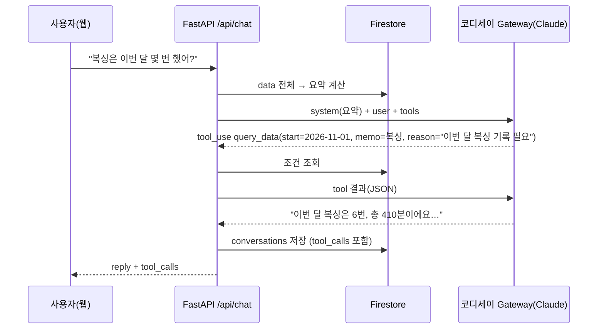
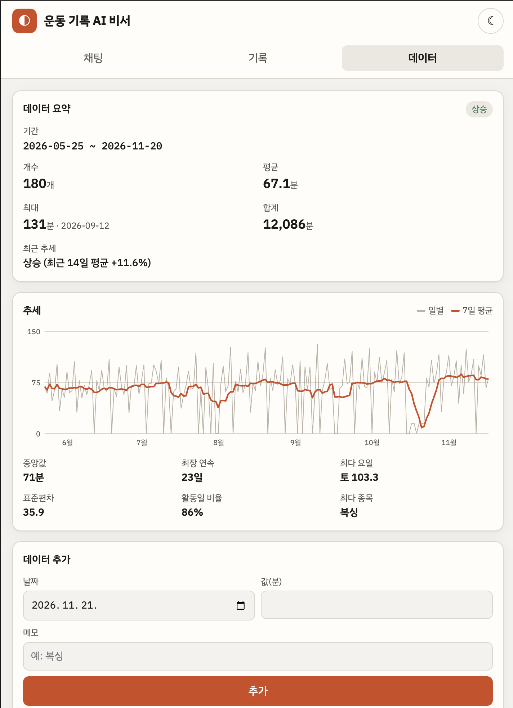
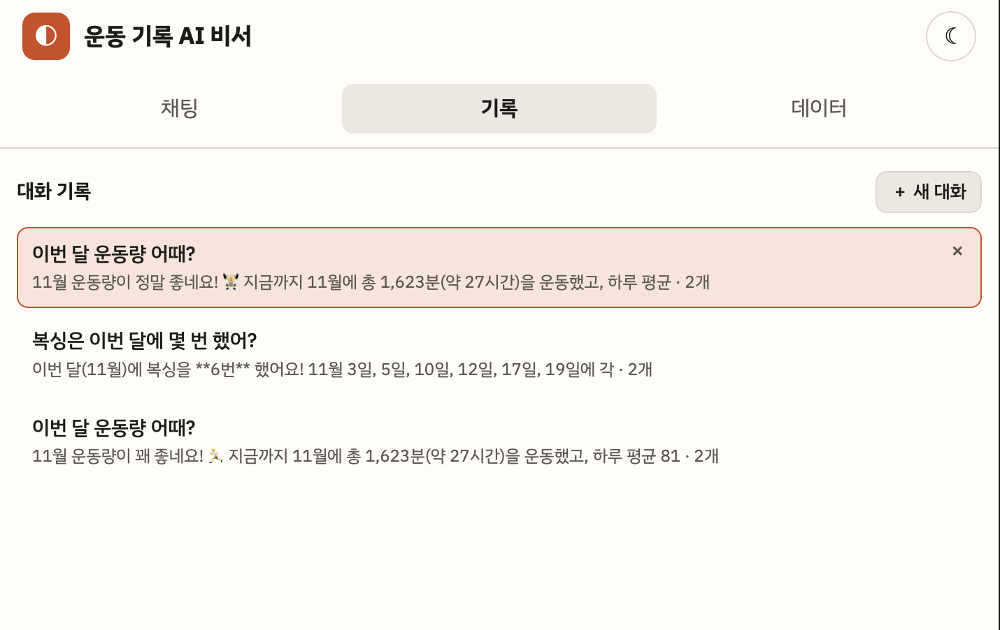

# 🏋️ 운동 기록 AI 비서 — 내 데이터를 아는 AI

일반 챗봇은 "이번 달 운동 많이 했어?"라고 물으면 일반론만 답합니다.
이 서비스는 **내 일일 운동 시간(분) 시계열 데이터**를 Firestore에 저장·분석하고, 그 **요약을 시스템 프롬프트에 주입**해서
"이번 달 합계 1,420분, 최근 14일 평균이 직전보다 11% 늘었어요"처럼 **내 상황에 맞춘 답**을 줍니다.

| 구분 | 주소 |
|---|---|
| 프론트엔드 (Vercel) | https://ai-assistant-frontend-virid.vercel.app |
| 백엔드 API (Render) | https://ai-assistant-api-ecqq.onrender.com |
| Swagger UI | https://ai-assistant-api-ecqq.onrender.com/docs |

> Render 무료 티어는 15분간 요청이 없으면 잠듭니다. 첫 접속은 30~60초 걸릴 수 있으며, 화면 상단에 안내 배너가 뜨고 자동으로 `/health`를 재시도합니다.

---

## 1. 주요 기능

| 기능 | 내용 |
|---|---|
| 데이터 기반 AI 채팅 | 질문 → 요약 조회 → 시스템 프롬프트 주입 → AI 답변, 로딩 표시, 대화 자동 저장 |
| 데이터 관리 (CRUD) | `(date, value, memo)` 추가 / 목록 / 수정 / 삭제, 저장 결과 토스트 |
| 대화 기록 | 대화 목록, 클릭해 불러오기(메시지 재표시), 삭제, 이어서 대화 |
| 데이터 요약 | 기간·개수·평균·최대·합계·최근 추세를 채팅 상단과 우측 패널에 표시 |
| **보너스** | Function Calling(도구 4종) + MCP 서버, 확장 통계 API, SVG 추세 그래프, CSV/JSON 내보내기, 다크 모드 |

## 2. 기술 스택

- **Backend**: Python 3.11, FastAPI, Uvicorn, Pydantic v2, firebase-admin(Firestore), python-dotenv (AI 호출은 표준 라이브러리 urllib) → **Render**
- **Frontend**: HTML / CSS / JavaScript (프레임워크·차트 라이브러리 없음, 그래프는 SVG 직접 렌더링) → **Vercel**
- **DB**: Firebase Firestore (`data`, `conversations` 컬렉션)
- **AI**: 코디세이 AI Gateway(`copa.codyssey.kr`, 기본 모델 `claude-haiku-4`) — Anthropic Messages 형식 기본, OpenAI 호환 형식 자동 전환, 두 형식 모두 Function Calling(도구 호출) 지원
  - 과제 명세는 GPT API(openai 패키지)를 예시로 들지만, 코디세이에서 제공하는 Gateway 키를 사용하도록 바꿨습니다. 컨텍스트 주입·도구 호출 구조는 동일합니다.
- **Bonus**: MCP Python SDK (`mcp`)

## 3. 프로젝트 구조

```
ai-assistant/
├── backend/
│   ├── main.py                 # 앱 초기화, CORS, 라우터 등록, /health, 전역 예외 처리
│   ├── app/
│   │   ├── config.py           # 환경 변수 로딩 (키 하드코딩 없음)
│   │   ├── database.py         # Firestore Repository (+ 로컬 테스트용 Memory)
│   │   ├── schemas.py          # Pydantic 요청/응답 모델 (입력 검증)
│   │   ├── routers/            # HTTP 계층: data.py, conversations.py, chat.py
│   │   └── services/           # 비즈니스 로직
│   │       ├── data_service.py          # CRUD
│   │       ├── summary_service.py       # 요약·트렌드·확장 통계
│   │       ├── conversation_service.py  # 대화 저장/목록/상세
│   │       ├── chat_service.py          # 컨텍스트 주입 + AI 호출 + 자동 저장
│   │       ├── llm.py                   # 코디세이 Gateway 클라이언트 (Anthropic/OpenAI 형식, 도구 호출)
│   │       └── tools.py                 # Function Calling 도구 정의/실행
│   ├── data/workout_log.csv    # 시계열 데이터 180일
│   ├── scripts/seed_data.py    # CSV → Firestore 업로드
│   ├── tests/test_services.py  # Firebase·AI 키 없이 도는 테스트 (가짜 Gateway)
│   ├── requirements.txt
│   └── .env.example
├── frontend/
│   ├── public/ (index.html, style.css, app.js, config.js)
│   ├── build.js               # Vercel 환경변수 API_BASE_URL → config.js
│   └── vercel.json
├── mcp_server/server.py       # (보너스) MCP 서버
└── render.yaml
```

**분리 기준**: `routers`는 HTTP(경로·상태코드·의존성)만, `services`는 순수 로직만 담당합니다. 서비스는 FastAPI를 import하지 않아서 테스트·MCP·스크립트에서 그대로 재사용되고, DB 접근은 `Repository` 인터페이스로 감싸 Firestore ↔ 메모리 저장소를 바꿔도 로직이 바뀌지 않습니다.

## 4. 데이터 선정과 분석

- **데이터**: 2026-05-25 ~ 2026-11-20, **180일**의 일일 운동 시간(분). 메모에 종목(웨이트·복싱·클라이밍·러닝·휴식) 기록. 10월 셋째 주는 중간고사로 감소 구간이 있습니다.
- **요약 (`GET /api/data/summary`)**: 기간, 개수, 합계/평균/최대/최소(+해당 날짜), **트렌드** = 마지막 날짜 기준 *최근 14일 평균* vs *직전 14일 평균* 변화율 (±5% 이내 '유지')
- **확장 통계 (`GET /api/data/statistics`, 보너스)**: 중앙값, 표준편차, 활동일 비율, 최장 연속 운동일, 요일별 평균, 월별 합계/평균, 7일 이동평균, 종목별 횟수

```json
{
  "period": "2026-05-25 ~ 2026-11-20",
  "count": 180,
  "metrics": { "total": 12086.0, "average": 67.14, "max": 131.0, "min": 0.0,
               "max_date": "2026-09-12", "min_date": "2026-06-14" },
  "trend": "상승 (최근 14일 평균 +11.6%)",
  "recent_average": 82.43, "previous_average": 73.86, "unit": "분"
}
```

> 내 실제 기록으로 바꾸려면 `date,value,memo` 헤더의 CSV를 만들어 `python scripts/seed_data.py --csv 내파일.csv --reset` 하세요. 다른 종류의 데이터라면 환경 변수 `DATA_LABEL`, `DATA_UNIT`만 바꾸면 프롬프트에 반영됩니다.

## 5. API

| 메서드 | 경로 | 설명 |
|---|---|---|
| POST | `/api/data` | 데이터 추가 (201) |
| GET | `/api/data?start=&end=&limit=` | 목록 (날짜 오름차순) |
| PUT | `/api/data/{id}` | 수정 (보낸 필드만 부분 수정) |
| DELETE | `/api/data/{id}` | 삭제 |
| GET | `/api/data/summary` | 요약 (프롬프트 주입용) |
| GET | `/api/data/statistics` | 확장 통계 (보너스) |
| POST | `/api/conversations` | 대화 저장 |
| GET | `/api/conversations` | 대화 목록 — **messages 미포함**(제목·미리보기·개수만) |
| GET | `/api/conversations/{id}` | 대화 상세 — 전체 messages (요구사항 **A안**) |
| DELETE | `/api/conversations/{id}` | 대화 삭제 |
| POST | `/api/chat` | AI 대화 `{message, conversation_id?, use_tools}` |
| GET | `/health` | 헬스 체크 |

**입력 검증 (Pydantic)**: 날짜 형식, `0 ≤ value ≤ 1,000,000`, 무한대/NaN 거부, 메모 200자, 채팅 메시지 1~2000자·공백만 금지 → 위반 시 422. 없는 ID는 404, AI 호출 실패는 502(한도 초과 429), 키 미설정은 503, 그 외 예외는 내부 내용 노출 없이 500.

## 6. 컨텍스트 주입 원리

언어 모델은 학습 데이터 외에 **이번 요청 메시지**만 압니다. 그래서 매 요청마다 DB에서 요약을 계산해 **system 메시지**에 텍스트로 넣어 주면, 모델은 그 숫자를 "사실"로 보고 답합니다. 전체 180행 대신 요약만 넣으므로 토큰(=비용)이 적고, 데이터를 수정하면 다음 질문부터 바로 반영됩니다.

```
당신은 사용자의 개인 데이터를 이해하는 데이터 분석 비서입니다.

[사용자 데이터 요약]
- 데이터 종류: 일일 운동 시간 (단위: 분)
- 데이터 기간: 2026-05-25 ~ 2026-11-20
- 총 레코드: 180개
- 주요 지표: 합계 12086.0분, 평균 67.14분, 최대 131.0분(2026-09-12), 최소 0.0분(2026-06-14)
- 최근 트렌드: 상승 (최근 14일 평균 +11.6%) (최근 14일 평균 82.43분, 직전 14일 평균 73.86분)

오늘 날짜: 2026-11-21 (Asia/Seoul)
규칙: 요약·도구 결과의 숫자만 근거로 답하고 없는 수치는 지어내지 말 것 …
```

`POST /api/chat` 흐름: ① 요약 조회 → ② 시스템 프롬프트 삽입 (+ 이어지는 대화면 최근 10개 메시지) → ③ 코디세이 Gateway 호출 → ④ user/assistant 메시지를 `conversations`에 자동 저장 (새 대화면 문서 생성, 아니면 append)

## 7. 보너스 ① — Function Calling + MCP

요약만으로는 "11월 3일엔?", "복싱은 몇 번?" 같은 질문에 답할 수 없습니다. 그래서 AI가 **스스로 판단해** 내부 기능을 호출하도록 도구 4개를 정의했습니다. 모든 도구는 `reason`(호출 근거) 인자를 필수로 받고, 이 값이 채팅 화면의 🔧 칩과 API 응답 `tool_calls`에 그대로 표시됩니다.

| 도구 | 호출 근거 (언제 부르나) |
|---|---|
| `get_data_summary` | 요약이 방금 바뀌었거나 최신 전체 수치가 필요할 때 |
| `get_statistics` | 요일별·월별·종목별 비교, 연속 기록 질문 |
| `query_data(start_date, end_date, memo_keyword, limit)` | "이번 달", "지난주", "복싱한 날" 등 특정 기간/항목 |
| `list_conversations(limit)` | "전에 뭐 물어봤지?" |



라운드는 최대 3회로 제한해 무한 호출·과금을 막습니다. 채팅 입력창의 **도구** 체크를 끄면 요약 주입만으로 답합니다(비교 실험용).

**MCP 서버 (외부 채널)** — `mcp_server/server.py`는 같은 기능을 MCP 도구(`get_data_summary`, `get_statistics`, `query_data`, `add_record`, `list_conversations`, `ask_assistant`)로 노출합니다. MCP 서버는 배포된 REST API만 호출하므로 AI/Firebase 키는 Render에만 있습니다.

```bash
cd mcp_server && python -m venv .venv && source .venv/bin/activate
pip install -r requirements.txt
```

Claude Desktop `claude_desktop_config.json`:
```json
{
  "mcpServers": {
    "workout-assistant": {
      "command": "/절대경로/mcp_server/.venv/bin/python",
      "args": ["/절대경로/mcp_server/server.py"],
      "env": { "API_BASE_URL": "https://ai-assistant-api-ecqq.onrender.com" }
    }
  }
}
```
검증: Claude Desktop에서 "내 운동 요약 알려줘" → `get_data_summary` 호출 확인, "어제 복싱 70분 추가해줘" → `add_record` 후 웹 화면 목록에 반영되는지 확인. (스크린샷: `docs/screenshots/mcp.png`)

## 8. 보너스 ② — 인사이트·UX

- `GET /api/data/statistics`: 추가 지표(중앙값, 표준편차, 최장 연속, 요일별·월별, 종목별)
- 추세 그래프: 일별 값 + 7일 이동평균 SVG (호버/터치 툴팁)
- CSV(엑셀 한글 BOM 포함) / JSON 다운로드
- 다크 모드 토글 (시스템 설정 따름 + 선택 기억)

## 9. 로컬 실행

```bash
# 백엔드
cd backend
python3 -m venv venv && source venv/bin/activate     # Windows: venv\Scripts\activate
pip install -r requirements.txt
cp .env.example .env        # 키 입력 (Firebase 키 파일은 backend/serviceAccountKey.json)
python scripts/seed_data.py # 180개 데이터 업로드 (처음 한 번)
uvicorn main:app --reload   # http://localhost:8000/docs

# 테스트 (Firebase·AI 키 없이)
python tests/test_services.py

# 프론트엔드 (새 터미널)
cd frontend
python3 -m http.server 5500 --directory public      # http://localhost:5500
```

Firebase 키 없이 화면만 확인하려면 `.env`에 `USE_MEMORY_DB=true` 후 `python scripts/seed_data.py`는 건너뛰고 화면에서 데이터를 추가하세요(재시작 시 초기화).

## 10. 환경 변수

| 변수 | 위치 | 필수 | 설명 |
|---|---|---|---|
| `AI_API_KEY` | Render | ✅ | 코디세이 콘솔(copa.codyssey.kr)에서 발급한 키 |
| `FIREBASE_SERVICE_ACCOUNT_JSON` | Render | ✅ | 서비스 계정 JSON 전체(한 줄) 또는 base64. 로컬은 `FIREBASE_CREDENTIALS_PATH` 사용 가능 |
| `ALLOWED_ORIGINS` | Render | ✅ | CORS 허용 도메인, 쉼표 구분 (`https://ai-assistant-frontend-virid.vercel.app`) |
| `API_BASE_URL` | Vercel | ✅ | 백엔드 주소 (빌드 시 `config.js`로 주입) |
| `AI_BASE_URL` | Render | | 기본 `https://copa.codyssey.kr` |
| `AI_MODEL` | Render | | 기본 `claude-haiku-4` (콘솔의 사용 가능 모델명) |
| `AI_API_FORMAT` | Render | | 비우면 자동(Anthropic → 404/405 시 OpenAI 호환), `anthropic`/`openai` 고정 가능 |
| `AI_MAX_TOKENS` | Render | | 기본 500 (비용 제한) |
| `CHAT_HISTORY_LIMIT` | Render | | 프롬프트에 넣을 이전 메시지 수, 기본 10 |
| `DATA_LABEL`, `DATA_UNIT` | Render | | 데이터 이름/단위 (기본 "일일 운동 시간", "분") |
| `USE_MEMORY_DB` | 로컬 | | `true`면 Firestore 대신 메모리 |

`.env`, 서비스 계정 키 파일은 `.gitignore`로 커밋을 막습니다. 프론트의 `API_BASE_URL`은 공개되는 값이라 비밀값을 넣지 않습니다.

## 11. 배포

**Firebase**: 콘솔 → 프로젝트 생성 → Firestore Database 생성 → 프로젝트 설정 › 서비스 계정 › *새 비공개 키 생성* (JSON 다운로드)

**Render (백엔드)**: New › Web Service › Public Git Repository(`https://github.com/JSH-ama-web/ai-assistant`) — 이 방식은 push 시 자동 배포가 안 되므로 코드 변경 후 *Manual Deploy › Deploy latest commit*
- Root Directory `backend` · Build `pip install -r requirements.txt` · Start `uvicorn main:app --host 0.0.0.0 --port $PORT`
- Environment에 위 표의 Render 변수 입력 (`PYTHON_VERSION=3.11.9` 권장) → 배포 후 `/docs` 확인
- 데이터 업로드는 로컬에서 `seed_data.py` 실행 (같은 Firestore를 사용)

**Vercel (프론트엔드)**: Add New › Project › 같은 저장소 › Root Directory `frontend`
- Environment Variables: `API_BASE_URL=https://ai-assistant-api-ecqq.onrender.com` → Deploy
- 배포 URL을 Render의 `ALLOWED_ORIGINS`에 추가 후 재배포 (`*.vercel.app` 프리뷰는 정규식으로 허용됨)

**콜드스타트 대응**: 프론트가 진입 시 `/health`를 최대 6회 재시도하며 안내 배너 표시, 채팅 로딩 8초 초과 시 "서버가 깨어나는 중" 문구로 변경, 요청 타임아웃 90초.

**비용 대응**: `max_tokens=500`, `temperature=0.4`, 도구 라운드 3회 제한, 이력 10개 제한, 전체 데이터가 아닌 요약만 주입. 코디세이 콘솔에서 사용량을 수시로 확인하세요. 배포 후 `/health` 응답의 `ai` 항목으로 키 설정 여부·주소·모델·감지된 형식을 확인할 수 있습니다(키 값은 노출 안 됨).

## 12. 스크린샷

| 화면 | 파일 |
|---|---|
| 데이터 요약이 보이는 채팅 (질문+답변) | `docs/screenshots/chat.png` |
| 데이터 관리 (추가/수정/삭제 동작) | `docs/screenshots/data.png` |
| 대화 기록 (불러오기 동작) | `docs/screenshots/history.png` |
| Swagger UI | `docs/screenshots/swagger.png` |
| (보너스) 도구 호출 칩 / MCP | `docs/screenshots/tools.png`, `mcp.png` |

<!-- 배포 후 캡처해서 위 경로에 넣고 아래 주석을 해제하세요



-->
